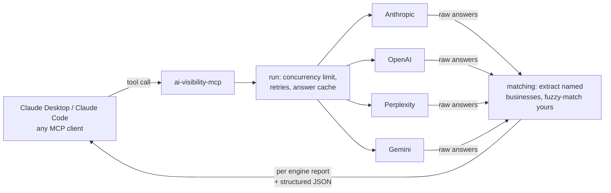

# ai-visibility-mcp

[](https://github.com/d1fpc3/ai-visibility-mcp/actions/workflows/ci.yml)


An open-source [Model Context Protocol](https://modelcontextprotocol.io) server that lets Claude check whether
AI assistants recommend a business.

Ask Claude *"Does ChatGPT recommend Eco-Cool HVAC for AC repair in Bel Air?"* and it can now find out. The server
asks Claude, ChatGPT, Perplexity and Gemini the questions real customers ask, finds every business each one
names, and reports whether yours made the list, where it ranked, what was said, and who got named instead.

## How it works



1. Each question goes to every engine you have a key for, in parallel, capped by a concurrency limit.
2. Each answer is parsed for the businesses it recommends (numbered lists, bullets, headings, bold names,
   "Best overall: X" labels), in order.
3. Your business is matched against those names with variant-tolerant matching, and against passing mentions in
   the prose and your website domain.
4. Results come back as readable text for the model plus `structuredContent` that validates against a declared
   `outputSchema`.

## Tools

| Tool | What it does |
| --- | --- |
| `ask_engines` | Ask one customer question to every configured engine and return the raw answers and cited sources. |
| `check_visibility` | Run a list of questions and report, per engine and per question: named or not, position, an evidence quote and the competitors named instead. |
| `suggest_questions` | Write 8 to 12 realistic customer questions for a business type and city. Uses a model if one is configured, otherwise a built-in template set. |
| `compare_competitors` | Rank which businesses the engines name most across a set of questions, with mention counts, which assistants named them and average position. |

Also exposed:

- **Prompt** `visibility_report`: walks the model through suggest, check, compare and a written audit with fixes.
- **Resource** `ai-visibility://engines`: which engines are configured, their models and the run limits (never keys).

All tools are marked `readOnlyHint`, and the network-calling ones `openWorldHint`.

## Install

Requires Node 22+. Clone and build:

```bash
git clone https://github.com/d1fpc3/ai-visibility-mcp.git
cd ai-visibility-mcp
npm install
npm run build
```

### Claude Code

```bash
claude mcp add ai-visibility \
  -e ANTHROPIC_API_KEY=sk-ant-... \
  -e OPENAI_API_KEY=sk-... \
  -- node /absolute/path/to/ai-visibility-mcp/dist/index.js
```

### Claude Desktop

Add this to `claude_desktop_config.json` (Settings, Developer, Edit Config) and restart Claude Desktop:

```json
{
  "mcpServers": {
    "ai-visibility": {
      "command": "node",
      "args": ["/absolute/path/to/ai-visibility-mcp/dist/index.js"],
      "env": {
        "ANTHROPIC_API_KEY": "sk-ant-...",
        "OPENAI_API_KEY": "sk-...",
        "PERPLEXITY_API_KEY": "pplx-...",
        "GEMINI_API_KEY": "..."
      }
    }
  }
}
```

### Over HTTP

```bash
node dist/index.js --http --port 3333
# MCP endpoint: http://127.0.0.1:3333/mcp (stateless Streamable HTTP)
```

## Configuration

Each engine turns on only when its key is set. Set at least one.

| Variable | Default | Notes |
| --- | --- | --- |
| `ANTHROPIC_API_KEY` | | Enables Claude |
| `OPENAI_API_KEY` | | Enables ChatGPT |
| `PERPLEXITY_API_KEY` | | Enables Perplexity (returns cited sources) |
| `GEMINI_API_KEY` or `GOOGLE_API_KEY` | | Enables Gemini |
| `AIV_ANTHROPIC_MODEL` | `claude-haiku-5-5` | |
| `AIV_OPENAI_MODEL` | `gpt-5-mini` | |
| `AIV_PERPLEXITY_MODEL` | `sonar` | |
| `AIV_GEMINI_MODEL` | `gemini-2.5-flash` | |
| `AIV_CONCURRENCY` | `4` | Max engine calls in flight at once |
| `AIV_TIMEOUT_MS` | `45000` | Per attempt |
| `AIV_MAX_RETRIES` | `2` | On 429, 5xx, timeouts and network errors |
| `AIV_CACHE_TTL_SECONDS` | `600` | Reuse identical question answers for this long |
| `AIV_MAX_QUESTIONS` | `12` | Per tool call, so one request can't run up a bill |

## Design notes

**Matching.** Assistants write the same business many ways: "Eco-Cool HVAC LLC", "EcoCool", "Eco Cool Heating &
Air". Names are normalized (case, accents, punctuation, `&` vs `and`, a leading "The", trailing LLC/Inc/Co), then
compared as token sets with one-typo tolerance on longer words, squashed-spacing checks ("EcoCool" vs "Eco Cool")
and trade-word groups, so "Heating" and "HVAC" agree but "Plumbing" and "HVAC" do not. A name made only of trade
words ("Heating and Cooling") never matches anyone. Aliases and the website domain count as matches too.

**Extraction.** Business names come from list items, headings, bold spans and "Best overall:" labels, cut at the
first dash, colon, bracket or verb. Indented detail lines (`**Phone:**`, `**Why they stand out:**`), advice lines
("Tips", "Bottom line") and category headings ("Top HVAC Companies in Bel Air") are dropped. Spelling variants
are merged so competitor counts are not split.

**Reliability.** Every call has a timeout, retries with exponential backoff and full jitter (honoring
`Retry-After`), and fails fast on 4xx errors that retrying cannot fix. One engine failing never sinks a run: its
error is reported next to the answers that worked. Client cancellation is passed through to in-flight requests.

**Cost control.**
- Small, fast default models.
- A hard cap on questions per call.
- Duplicate questions inside a run are asked once.
- An answer cache keyed on engine, model and normalized question is shared across tool calls, so
  `check_visibility` followed by `compare_competitors` on the same questions costs one set of calls.
- Failed calls are never cached.

**Protocol.** Built on the official TypeScript SDK with zod input and output schemas, tool annotations, a prompt
and a resource. stdout is reserved for the protocol, and all logs go to stderr.

## Development

```bash
npm run check   # typecheck, lint (Biome), tests (Vitest), build, smoke test
```

- `test/` has 66 tests: matching and extraction, retries and timeouts, each provider's request and response shape,
  the concurrency limiter and cache, report building, and an in-process MCP client that calls every tool, prompt
  and resource against mock engines.
- `scripts/smoke.mjs` starts the built server and speaks raw JSON-RPC to it over stdio and Streamable HTTP.
- No API keys are needed to run any of it.

## Hosted version

This is the small self-hosted cousin of [SeenRank](https://seenrank.com). SeenRank tracks AI visibility weekly
for local businesses, explains why a business was left out, and writes the fixes.

## Author

Built by Frankie Claridge ([github.com/d1fpc3](https://github.com/d1fpc3)).

MIT licensed.
